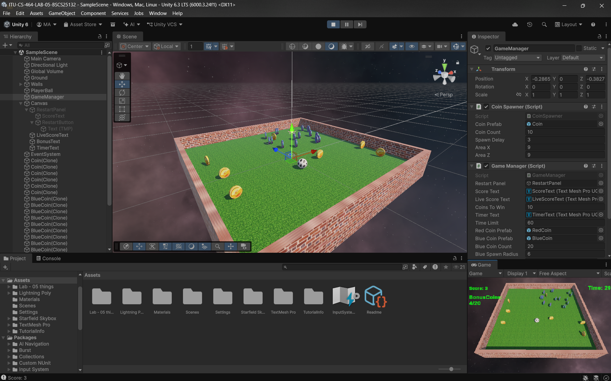

# ITU-CS-464-LAB-05-BSCS25132

# Coin Collector Ball Game

**Student:** Muhammad Abdullah (BSCS25132)
**Course:** CS-464 Game Development, ITU | **Lab:** 05

A simple 3D Unity game where you roll a ball and collect coins before the timer ends.

## Game Idea
Collect 10 coins within 60 seconds to win. When the game ends, a panel shows your total score and a Restart button.

## Features
- Coins spawn automatically, one by one, at random places
- Live score and countdown timer
- Red Coin appears once at a random score (1 to 10)
- Collecting the Red Coin spawns 20 Blue Coins around the player
- Hidden BonusCoins: 0/20 text appears and counts the Blue Coins
- Different sounds for gold coins and the red coin
- Textures on coins and ball
- Smooth camera that follows the ball

## Links
- Gameplay Video: https://drive.google.com/file/d/15EArYNC_QWBdaHWbo7mGxKAqbDRHo_s0/view?usp=sharing
- Repo: https://github.com/MAbdullah-BSCS25132/ITU-CS-464-LAB-05-BSCS25132

## Screenshots

## Made With
Unity, C#